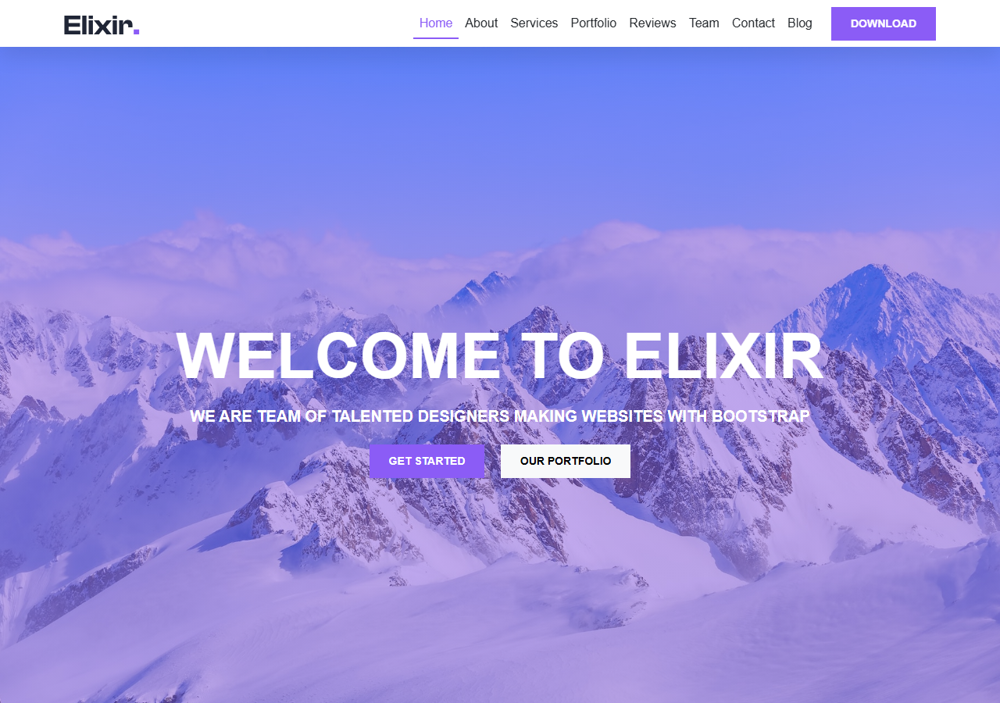
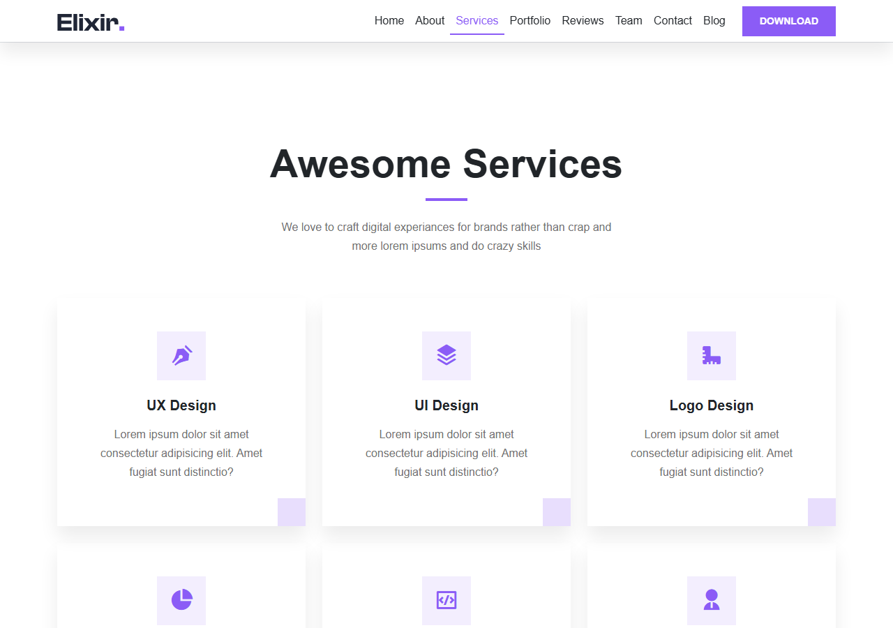
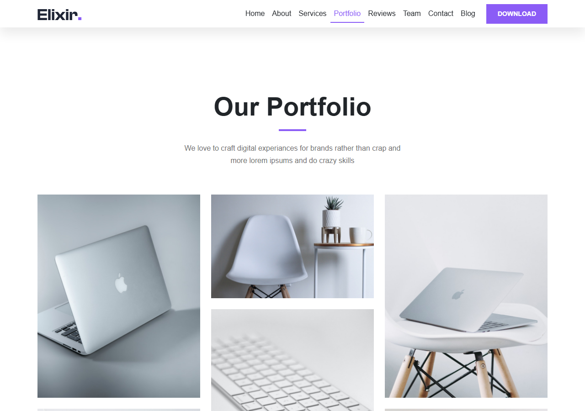

# Elixir Website

A responsive agency / portfolio landing page for showcasing services, portfolio, testimonials, team, and blog, with contact section and modern purple theme.

## Screenshots

### Hero Home


### Services


### Portfolio


## Features

- Responsive navbar with hover underline effect
- Full-screen hero with overlay
- About and services sections with hover cards
- Counter stats section
- Portfolio grid with image zoom and lightbox
- Testimonials and team members sections
- Contact form and blog preview
- Footer with social icons
- Scroll animations

## Technologies

- HTML
- CSS
- JavaScript
- Bootstrap
- RemixIcon
- Fancybox
- AOS

## Project Structure

```text
css/
JS/
views/
Resources/img/
screenshots/
README.md
```

## Installation

1. Clone the repository:

   ```bash
   git clone https://github.com/your-username/elixir-website.git
   ```

2. Run the project using a local Apache environment such as XAMPP.
3. Open `views/home.html` via `http://localhost/elixir-website/views/home.html`.

## Notes

This project was developed as a practical front-end landing page and demonstrates responsive layout, Bootstrap components, CSS variables for theming, scroll animations, and basic website structure.
